# Hey there! I'm Davide 👋

I like 🤓 learning new languages and 🎶 listening to music while I code, rock music helps me concentrate

  

## Languages & Frameworks

## Technologies & Tools

## AI

## Hobbies

